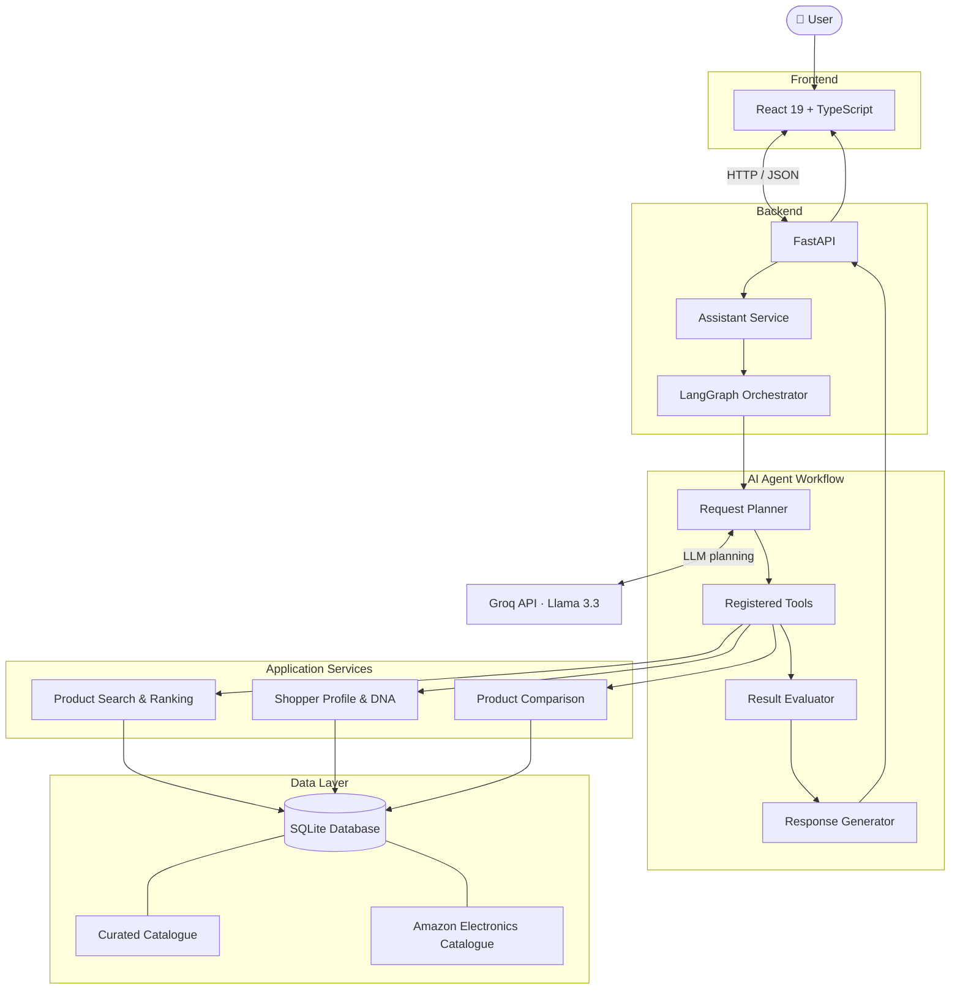
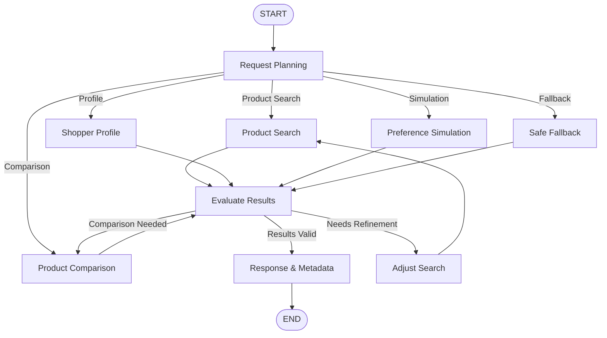
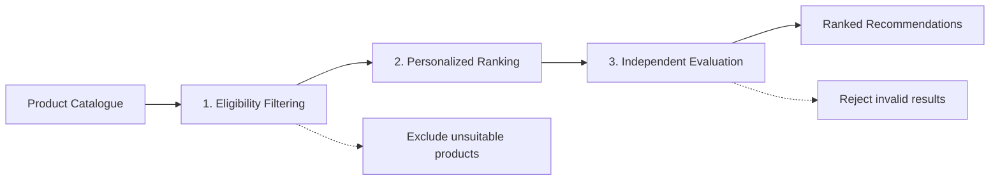

# 🛍️ SmartShopper AI

### Shop smarter. Discover better. Choose confidently.

**SmartShopper** is an AI-powered shopping intelligence platform that transforms natural-language shopping requests into personalized, explainable product recommendations.

Powered by **LangGraph, Groq, FastAPI, and React**, it combines conversational AI with deterministic recommendation logic to understand what users need, discover suitable products, compare alternatives, and make shopping decisions easier.

<p align="center">
  
  
  
  
  
  
  
</p>

---

## ✨ What is SmartShopper?

Imagine asking:

> "Find me wireless headphones under ₹5,000 with good battery life. I prefer Sony."

Instead of manually applying filters and browsing hundreds of products, SmartShopper understands the request, identifies the requirements, searches its product catalogue, considers shopping preferences, and returns relevant recommendations.

It doesn't just find products. It helps explain **why a product is a suitable choice.**

### Key Features

| Feature | Description |
|---|---|
| 💬 Conversational Shopping | Understands natural-language shopping requests and follow-up questions. |
| 🤖 AI Agent Orchestration | Uses LangGraph to coordinate planning, searching, comparison, and evaluation. |
| 🎯 Personalized Recommendations | Uses shopper preferences and confidence-aware scoring. |
| 🔍 Intelligent Product Discovery | Searches curated and imported product catalogues. |
| ⚖️ Product Comparison | Compares products using their specifications and attributes. |
| 🧬 Shopper DNA | Represents explicit and inferred shopping preferences. |
| 🧪 Decision Lab | Simulates preference changes and their effect on recommendations. |
| ✅ Recommendation Evaluation | Checks recommendations against the original shopping requirements. |

---

## 🏗️ How It Works

SmartShopper follows a structured architecture where the frontend communicates with the backend, and the backend coordinates the AI workflow and recommendation engine.



### The workflow in simple terms

1. **User Request:** The user describes what they want to buy.
2. **Understanding:** The assistant extracts requirements such as budget, brand, category, and specifications.
3. **Planning:** LangGraph coordinates the next action using the request context and available tools.
4. **Product Discovery:** The application searches the relevant product catalogue.
5. **Personalization:** Shopper preferences influence how eligible products are ranked.
6. **Evaluation:** The system checks whether the results satisfy the user's requirements.
7. **Response:** The assistant returns recommendations with relevant explanations.

---

## 🧠 Inside the LangGraph Agent

LangGraph is the orchestration engine behind SmartShopper.

It organizes the shopping process into individual nodes connected through conditional edges. Each node has a specific responsibility.



### Main workflow components

| Component | Responsibility |
|---|---|
| Request Planning | Determines which shopping operation should run next. |
| Product Search | Finds eligible products from the catalogue. |
| Product Comparison | Compares shortlisted products. |
| Shopper Profile | Retrieves saved user preferences. |
| Preference Simulation | Evaluates hypothetical preference changes. |
| Result Evaluation | Validates recommendations against user requirements. |
| Adjust Search | Refines the search when results need improvement. |
| Safe Fallback | Handles planning failures with controlled fallback behaviour. |
| Response Metadata | Prepares the final results and execution information. |

### Controlled Agent Execution

SmartShopper is designed to keep agent execution predictable.

- Maximum 3 planning iterations.
- Maximum 5 tool executions.
- The final available execution slot is reserved for evaluation.
- Only registered tools can be executed.
- Tool arguments are validated using Pydantic schemas.
- Execution fingerprints help prevent repeated calls.
- Every request receives fresh graph state.

The system also supports deterministic routing for explicit shopper-profile requests, avoiding unnecessary LLM planning.

---

## 🎯 Intelligent Recommendation Engine

One of SmartShopper's most important design decisions is separating AI reasoning from actual product selection.

**The LLM understands and plans. Application code filters, ranks, and validates products.**

The recommendation pipeline has three main stages:



### 1. Eligibility Filtering

Products are checked against mandatory requirements:

- Product category
- Minimum and maximum budget
- Preferred brand
- Minimum rating
- Availability requirements
- Connectivity and product type
- Battery life and required specifications

Products that fail mandatory requirements are excluded before ranking.

### 2. Personalized Ranking

Eligible products are ranked using the user's Shopper DNA.

The system considers preference values and their confidence scores, rather than treating every inferred preference as equally reliable.

**Confidence adjustment formula:**

\[
P_{\text{effective}} =
50 + (P_{\text{inferred}} - 50)
\times \frac{C}{100}
\]

Where:

- \(P_{\text{inferred}}\): Inferred preference score.
- \(C\): Confidence percentage.
- \(P_{\text{effective}}\): Confidence-adjusted preference score.

The neutral baseline is 50. Lower confidence pulls an inferred preference closer to neutral.

### 3. Independent Evaluation

Before recommendations are returned, the evaluator checks:

- Product IDs and product references.
- Original shopping constraints.
- Duplicate recommendations.
- Previously shown products.
- Missing required specifications.

This helps prevent unsuitable products from being presented as valid recommendations.

---

## 🧬 Shopper Profile & Shopper DNA

SmartShopper uses a shopper profile to personalize the shopping experience.

**Shopper Profile** stores information such as:

- Budget preferences.
- Preferred categories.
- Preferred brands.
- Disliked product attributes.

**Shopper DNA** represents preference information using:

| Attribute | Purpose |
|---|---|
| `inferred_preferences` | Represents preference values. |
| `confidence_scores` | Indicates confidence in inferred preferences. |
| `preference_sources` | Distinguishes explicit and inferred preferences. |

This allows the recommendation engine to use personalization without treating uncertain assumptions as confirmed preferences.

---

## 📦 Product Catalogues

SmartShopper supports two separate product catalogues.

### 1. Curated Product Catalogue

A locally maintained catalogue containing product information used for product discovery, filtering, comparison, and recommendations.

### 2. Amazon Electronics Catalogue

An imported electronics catalogue containing 500 product records sourced from the Amazon Reviews 2023 dataset.

| Product Category | Records |
|---|---:|
| Computers & Accessories | 150 |
| Headphones & Earbuds | 100 |
| Camera & Photo | 75 |
| Television & Video | 60 |
| Home Audio | 50 |
| Car Electronics | 20 |
| Portable Audio & Video | 20 |
| Wearable Technology | 15 |
| Other Electronics | 10 |
| **Total** | **500** |

**Data note:** Amazon catalogue prices use historical USD-to-INR conversions for illustrative purposes. They are not guaranteed to represent current Indian retail prices. Imported catalogue availability is not independently verified in real time.

---

## 🛠️ Technology Stack

| Layer | Technology |
|---|---|
| Frontend | React 19, TypeScript |
| Build Tool | Vite |
| Styling | Tailwind CSS v4 |
| Icons | Lucide Icons |
| Charts | Recharts |
| Backend | Python 3.11+, FastAPI |
| Validation | Pydantic v2 |
| ORM | SQLAlchemy 2 |
| Database | SQLite |
| Migrations | Alembic |
| Agent Orchestration | LangGraph 1.2 |
| LLM Integration | Groq, LangChain Core |
| Language Model | Llama 3.3 70B Versatile |
| HTTP Client | HTTPX |
| Testing | Pytest |

---

## 📁 Project Structure

```text
SmartShopper-LangGraph/
│
├── backend/
│   ├── app/
│   │   ├── agent/
│   │   │   ├── graph.py
│   │   │   ├── nodes.py
│   │   │   ├── routing.py
│   │   │   ├── state.py
│   │   │   ├── orchestrator.py
│   │   │   ├── schemas.py
│   │   │   ├── tool_registry.py
│   │   │   └── tools/
│   │   │
│   │   ├── api/
│   │   ├── core/
│   │   ├── database/
│   │   ├── models/
│   │   ├── schemas/
│   │   ├── services/
│   │   ├── data/
│   │   └── main.py
│   │
│   ├── alembic/
│   ├── tests/
│   └── requirements.txt
│
├── frontend/
│   ├── public/
│   ├── src/
│   ├── package.json
│   └── vite.config.ts
│
└── README.md
```

---

## 🚀 Getting Started

Follow these steps to run SmartShopper locally.

### Prerequisites

- Python 3.11 or later
- Node.js and npm
- Git
- Groq API key

### 1. Clone the Repository

```bash
git clone https://github.com/ishaankonathala/SmartShopper-LangGraph.git

cd SmartShopper-LangGraph
```

### 2. Set Up the Backend

```bash
cd backend

python3 -m venv .venv

source .venv/bin/activate

pip install -r requirements.txt
```

For Windows, activate the environment using:

```bash
.venv\Scripts\activate
```

### 3. Configure Environment Variables

```bash
cp .env.example .env
```

Update your `.env` file:

```env
APP_NAME=SmartShopper
APP_ENV=development
DEBUG=true

API_PREFIX=/api

DATABASE_URL=sqlite:///./smartshopper.db

CORS_ORIGINS=http://localhost:5173,http://127.0.0.1:5173

GROQ_API_KEY=your_groq_api_key
GROQ_MODEL=llama-3.3-70b-versatile

AI_PROVIDER=groq
```

Replace `your_groq_api_key` with your actual API key.

### 4. Initialize the Database

```bash
alembic upgrade head

python -m app.data.seed_cli
```

### 5. Start the Backend

```bash
uvicorn app.main:app --reload --host 127.0.0.1 --port 8000
```

Backend:

`http://127.0.0.1:8000`

API documentation:

`http://127.0.0.1:8000/docs`

### 6. Start the Frontend

Open another terminal:

```bash
cd frontend

npm install

npm run dev
```

Frontend:

`http://localhost:5173`

---

## 🔌 API Overview

All backend endpoints use the `/api` prefix.

| Module | Method | Endpoint |
|---|---|---|
| Health | GET | `/api/health` |
| Profiles | POST | `/api/profiles` |
| Profiles | GET | `/api/profiles/{user_id}` |
| Profiles | PUT | `/api/profiles/{user_id}` |
| Shopper DNA | GET | `/api/profiles/{user_id}/dna` |
| Shopper DNA | PUT | `/api/profiles/{user_id}/dna` |
| Assistant | POST | `/api/assistant/chat` |
| Recommendations | POST | `/api/recommendations` |
| Products | GET | `/api/products` |
| Product Details | GET | `/api/products/{product_id}` |
| Product Discovery | GET | `/api/discover/products` |
| Amazon Product | GET | `/api/discover/products/{asin}` |
| Shopping History | POST | `/api/history` |
| Shopping History | GET | `/api/history/{user_id}` |
| Decision Lab | POST | `/api/decision-lab/simulate` |

---

## 🧪 Testing

SmartShopper includes automated backend tests using Pytest.

Run the test suite:

```bash
cd backend

pytest -q
```

The tests cover:

- LangGraph workflow execution.
- Agent planning and conditional routing.
- Registered tool execution.
- Shopper profile and preference handling.
- Assistant intent extraction.
- Product filtering and ranking.
- Recommendation evaluation.
- API behaviour and validation.
- Search refinement and conversational context.

**Latest recorded test result:**

<details>
<summary>View test result</summary>

```text
478 passed
```

</details>

Frontend checks:

```bash
cd frontend

npm run lint

npm run build
```

---

## 💡 Key Engineering Decisions

| Decision | Why it matters |
|---|---|
| LangGraph orchestration | Makes the agent workflow structured and easier to control. |
| Registered tool allowlist | Prevents arbitrary tool execution. |
| Request-scoped state | Keeps individual shopping requests isolated. |
| Deterministic recommendations | Ensures mandatory shopping requirements are checked through code. |
| Confidence-aware personalization | Reduces the influence of uncertain inferred preferences. |
| Independent evaluation | Checks recommendations before they reach the user. |
| Bounded execution | Controls repeated actions and unnecessary LLM calls. |

---

## 🔮 Future Scope

SmartShopper can be extended with:

- Live retailer pricing and inventory integrations.
- Real-time product availability verification.
- Additional shopping categories and catalogue sources.
- More advanced preference learning.
- Persistent conversational memory.
- User feedback-driven recommendation improvements.
- Production deployment and monitoring.

---

## 👨‍💻 Project

**SmartShopper AI — LangGraph-Based Shopping Intelligence Platform**

**Repository:** [github.com/ishaankonathala/SmartShopper-LangGraph](https://github.com/ishaankonathala/SmartShopper-LangGraph)

**Built with:** Python · LangGraph · Groq · FastAPI · React · TypeScript

---

<p align="center">
  <strong>Smarter discovery. Better recommendations. Confident decisions.</strong>
</p>
