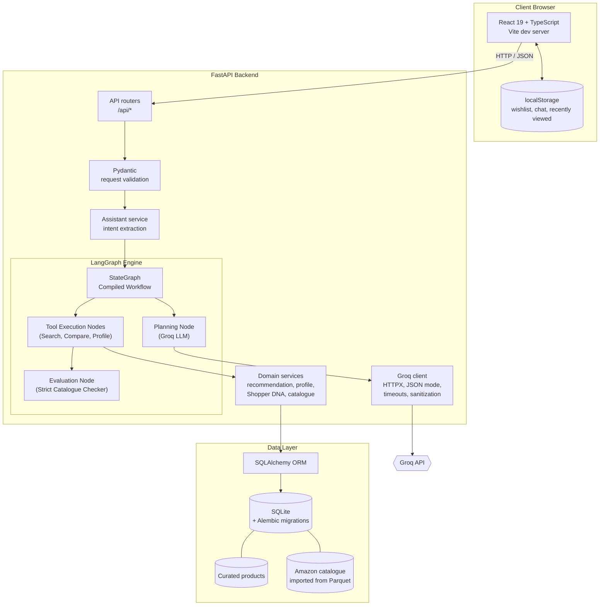
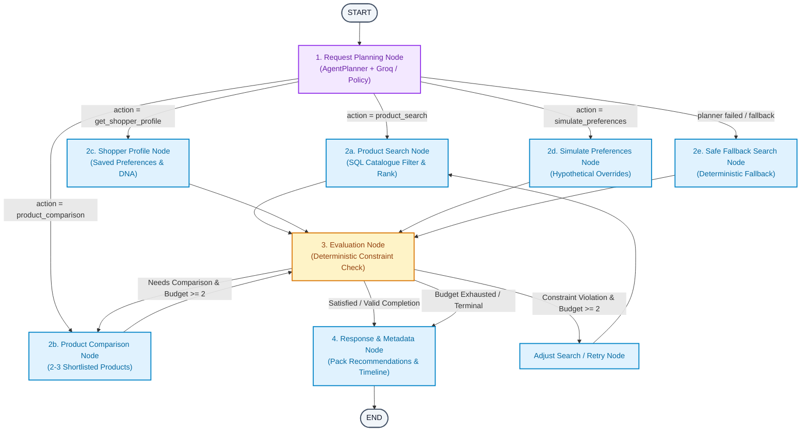
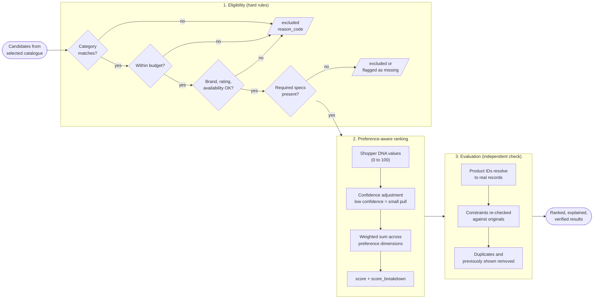
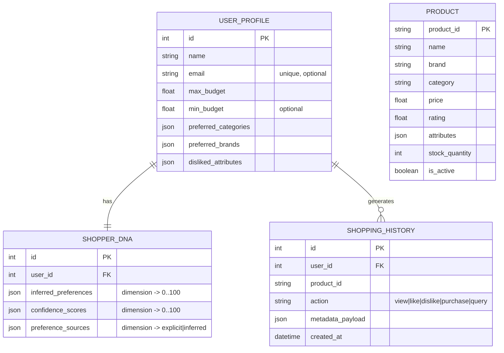

# SmartShopper AI (LangGraph Edition)

**A shopping assistant that orchestrates with LangGraph, reasons with Groq, and decides with deterministic code.**

[](#)
[](#)
[](#)
[](#)
[](#)
[](#)
[](#)

SmartShopper takes a natural language shopping request, such as *"wireless headphones under ₹5,000 with good battery life, Sony preferred"*, extracts validated constraints, runs a cyclical LangGraph workflow over registered tools, and returns ranked, verified recommendations.

The LLM (Groq) decides **what to do next**. It never decides **which products exist** or **which ones meet the budget**. Those decisions remain strictly deterministic, validated, and tested against the catalogue.

---

## Table of contents

- [Why LangGraph?](#why-langgraph)
- [Architecture](#architecture)
- [LangGraph Workflow Architecture](#langgraph-workflow-architecture)
  - [Workflow State Management](#workflow-state-management)
  - [Nodes & Responsibilities](#nodes--responsibilities)
  - [Edges & Conditional Routing](#edges--conditional-routing)
- [V1 (Custom Orchestrator) vs. V2 (LangGraph)](#v1-custom-orchestrator-vs-v2-langgraph)
- [Recommendation Pipeline](#recommendation-pipeline)
- [Data Model](#data-model)
- [Two Catalogues, Kept Apart](#two-catalogues-kept-apart)
- [Tech Stack](#tech-stack)
- [Project Structure](#project-structure)
- [Getting Started](#getting-started)
- [API Reference](#api-reference)
- [Testing](#testing)
- [Design Decisions](#design-decisions)
- [Limitations](#limitations)
- [License](#license)

---

## Why LangGraph?

In **SmartShopper V1**, agent execution relied on a custom Python loop inside `AgentOrchestrator` that alternated between Groq JSON planning and tool execution. While effective, custom loops:
- Entangle state mutation with control flow.
- Obscure branching conditions inside imperative `if/break` blocks.
- Hinder observability into cycle transitions, retries, and failure routing.

In **SmartShopper V2 (this repository)**, we adopted **LangGraph** because it formalizes the multi-step reasoning and execution pipeline into an explicit **cyclical directed graph (`StateGraph`)**:
1. **Explicit State Transitions**: Execution state (`ShopperGraphState`) is a typed, request-isolated contract updated deterministically across nodes.
2. **First-Class Conditional Routing**: Complex decisions (e.g. routing to comparison vs. retrying search vs. terminating with safe fallback) are pure, testable routing functions.
3. **Resilience & Bounded Cycles**: Hard iteration caps (maximum 3 planning iterations, maximum 5 tool calls) and deduplication prevent infinite loops and runaway costs.
4. **Clean Decoupling**: Business logic (SQL recommendations, attribute comparison, scoring) remains untouched; LangGraph acts purely as the orchestration engine.

---

## Architecture

### System Context



---

## LangGraph Workflow Architecture

The shopping assistant runs as an isolated, compiled LangGraph `StateGraph`:



### Workflow State Management

State is defined in `backend/app/agent/state.py` as a typed, request-scoped `ShopperGraphState`:

```python
class ShopperGraphState(TypedDict, total=False):
    objective: str
    user_id: int
    conversation_context: AssistantIntent | None
    constraints: AssistantIntent
    previously_shown_product_ids: list[str]
    exclude_previous_products: bool
    request_limit: int
    comparison_requested: bool
    fallback_search_allowed: bool
    execution_id: UUID
    current_plan: ToolSelection | None
    planning_failed: bool
    completed_steps: list[str]
    tool_results: list[ToolExecutionRecord]
    remaining_execution_budget: int
    tool_execution_count: int
    planning_iteration_count: int
    latest_evaluation: EvaluationResult | None
    execution_status: Literal["completed", "partial", "fallback", "unavailable"]
    seen_calls: list[str]
    next_action: str | None
```

- **Request Isolation**: Graph state is created fresh per request. No cross-request state leaks or persistent checkpoints exist in this stage.
- **Dual Compatibility**: Explicit conversion functions (`agent_state_to_graph_state` and `graph_state_to_agent_state`) provide complete interoperability with existing API handlers and tests.

### Nodes & Responsibilities

1. **`planning` (`request_planning_node`)**:
   - Evaluates policy shortcuts (e.g., auto-triggers product comparison if the user requested one and at least two eligible candidates exist).
   - Prompts Groq with validated constraints, available tools, and prior observations to select the next action.
   - Guards against repeated tool invocations using call fingerprinting.
   - Enforces the budget reservation rule (the last remaining tool slot is reserved for evaluation).
2. **`product_search` (`product_search_node`)**:
   - Calls the registered `search_products` tool backed by `generate_recommendations`.
   - Filters candidate items by category, price, brand, rating, connectivity, and battery life.
3. **`product_comparison` (`product_comparison_node`)**:
   - Extracts field-by-field differences (battery, comfort score, portability, price) between 2–3 selected products.
4. **`get_shopper_profile` (`shopper_profile_node`)**:
   - Reads the current shopper's saved profile, category affinities, and Shopper DNA without mutation.
5. **`simulate_preferences` (`simulate_preferences_node`)**:
   - Computes hypothetical recommendations based on temporary shopper preference overrides.
6. **`evaluate_results` (`evaluate_results_node`)**:
   - Deterministically verifies returned items against strict shopper filters (e.g., battery duration, connectivity, maximum budget).
   - Rejects items with missing required hardware specifications.
7. **`adjust_search` (`adjust_search_node`)**:
   - Adjusts search query parameters or excludes non-compliant products prior to retrying.
8. **`safe_fallback` (`safe_fallback_node`)**:
   - Runs a bounded, deterministic catalogue search if Groq experiences a network timeout, rate limit, or invalid JSON response.
9. **`response_metadata` (`response_metadata_node`)**:
   - Finalizes status and packages recommendations, comparison summaries, and user-facing timeline events.

### Edges & Conditional Routing

Routing logic is separated into `backend/app/agent/routing.py`:
- **`route_after_planning`**: Inspects `state["next_action"]` and routes to the appropriate tool node, fallback node, or response node.
- **`route_after_evaluation`**:
  - If satisfied and a comparison is requested and eligible: routes to `product_comparison`.
  - If satisfied or catalogue has no matches (`no_matches`): routes to `response_metadata`.
  - If constraint violation occurs and budget permits (`remaining_budget >= 2` and `iterations < 3`): routes to `adjust_search`.
  - If further planning is required and budget allows: routes back to `planning`.
  - Otherwise: terminates cleanly at `response_metadata`.

---

## V1 (Custom Orchestrator) vs. V2 (LangGraph)

| Dimension | SmartShopper V1 (Custom Agent) | SmartShopper V2 (LangGraph) |
|---|---|---|
| **Orchestration Model** | Imperative Python `while`-loop with state mutation | Cyclical directed graph (`StateGraph`) with nodes and edges |
| **State Representation** | Dataclass (`AgentState`) mutated in-place | Typed dictionary (`ShopperGraphState`) with request isolation |
| **Routing Logic** | Hardcoded conditional `break` / `continue` statements | Pure, declarative routing functions (`route_after_*`) |
| **Extensibility** | Adding an agent step requires modifying orchestrator loops | Adding a node or edge requires a single `workflow.add_node` / `add_edge` call |
| **Failure Recovery** | Inline fallback checks inside catch blocks | Dedicated `safe_fallback` node and conditional routing |
| **API Contract** | Preserved (`AgentRunResult`, `AgentExecutionMetadata`) | 100% backward-compatible (zero frontend changes required) |
| **Test Coverage** | 462 passing tests | 473 passing tests (baseline + dedicated LangGraph integration suite) |

---

## Recommendation Pipeline

Recommendations are produced by code, not by the model. The pipeline has three stages:



**Confidence adjustment:** Shopper DNA stores a preference value and a confidence value for each dimension. The effective value is pulled toward a neutral midpoint in proportion to confidence:

$$
P_{\text{effective}} = 50 + \bigl(P_{\text{inferred}} - 50\bigr)\cdot\frac{C}{100}
$$

---

## Data Model



---

## Two Catalogues, Kept Apart

SmartShopper isolates curated products from imported Amazon products:
- **Curated Catalogue**: Verified, high-quality audio products seeded locally. Always verified for availability.
- **Amazon Catalogue**: Historical dataset imported from Amazon Reviews (2023). Prices are historical and illustrative; availability is unverified.

The evaluator clearly annotates price provenance and data provenance for all shortlists.

---

## Tech Stack

- **Orchestration**: LangGraph 1.2, LangChain Core 1.8
- **Backend**: FastAPI, Pydantic v2, SQLAlchemy 2.0, Alembic, SQLite
- **LLM / Client**: Groq (`llama-3.3-70b-versatile`), HTTPX
- **Frontend**: React 19, TypeScript, Vite, Tailwind CSS v4, Lucide Icons, Recharts
- **Testing & Tooling**: Pytest, Pytest-Asyncio, Oxlint

---

## Project Structure

```
SmartShopper-LangGraph/
├── backend/
│   ├── app/
│   │   ├── agent/                  # LangGraph Workflow Architecture
│   │   │   ├── graph.py            # StateGraph builder and compiled graph
│   │   │   ├── nodes.py            # Individual LangGraph node functions
│   │   │   ├── routing.py          # Conditional edge routing functions
│   │   │   ├── orchestrator.py     # AgentOrchestrator LangGraph adapter
│   │   │   ├── state.py            # AgentState and ShopperGraphState
│   │   │   ├── schemas.py          # Tool input/output schemas
│   │   │   ├── tool_registry.py    # Allowlist tool registry
│   │   │   └── tools/              # Registered shopping tools
│   │   ├── api/                    # FastAPI routes (/api/*)
│   │   ├── core/                   # Configuration and settings
│   │   ├── database/               # Engine and session factory
│   │   ├── models/                 # SQLAlchemy ORM models
│   │   ├── schemas/                # Pydantic schemas (assistant, profile, etc.)
│   │   └── services/               # Recommendation, Groq client, intent parser
│   ├── alembic/                    # Database migrations
│   └── tests/                      # Pytest suite (473 tests)
│       └── test_langgraph_workflow.py  # LangGraph node & integration tests
└── frontend/                       # React 19 + TypeScript UI
```

---

## Getting Started

### 1. Backend Setup

```bash
cd backend
python3 -m venv .venv
source .venv/bin/activate
pip install -r requirements.txt

cp .env.example .env       # Configure GROQ_API_KEY
alembic upgrade head
python -m app.data.seed_cli

uvicorn app.main:app --reload --host 127.0.0.1 --port 8000
```

### 2. Frontend Setup

```bash
cd frontend
npm install
npm run dev
```

Visit **http://localhost:5173**.

---

## Testing

Run the full backend test suite:

```bash
cd backend
.venv/bin/pytest
```

Output:
```
============================= 473 passed in 2.94s ==============================
```

Run frontend lint and production build:

```bash
cd frontend
npm run lint
npm run build
```

---

## Design Decisions

1. **Why LangGraph for V2?** Upgraded from the V1 custom loop to LangGraph to model multi-step planning, bounded evaluation cycles, and retry adjustments as a clean `StateGraph`.
2. **Why Request-Scoped State?** Graph state is instantiated fresh per user turn, avoiding memory leaks or cross-tenant contamination.
3. **Why Keep the Allowlist Tool Registry?** The model never executes arbitrary code; all tool invocations are checked against registered Pydantic schemas.
4. **Why Deterministic Evaluation?** Strict catalogue checks (budget caps, battery specs, brand filters) are verified in code, ensuring zero LLM hallucination.

---

## License

MIT
